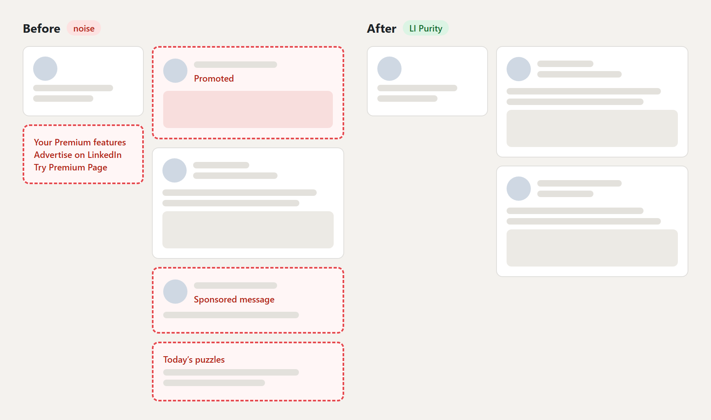

# LI Purity

**Make LinkedIn browsing great again.** A small Chrome extension that strips ads and noise out of LinkedIn.

## What it removes

- **Promoted posts** in the feed
- **Sidebar ads** and the **Today's puzzles** card
- The **Premium / Advertise on LinkedIn** upsell card
- **Sponsored messages**: hidden right away, then **permanently deleted** from your inbox on LinkedIn. InMail and normal conversations are never touched.

## Stats

The toolbar badge shows how many ads were blocked in the current tab. Click the icon for totals: today, last 7 days, and all time.

  
  &nbsp;
  

## Install

1. Download this repository (**Code → Download ZIP**) and unzip it, or `git clone` it.
2. Open `chrome://extensions` and turn on **Developer mode** (top right).
3. Click **Load unpacked** and select the folder.
4. Reload LinkedIn.

To update, pull or download the new version, then click the reload icon on the extension's card.

## Privacy

Everything runs locally in your browser. No data is collected or sent anywhere; the stats are stored in Chrome's local extension storage.

## Debugging

In the LinkedIn tab's console run `localStorage.lipDebug = 1` and reload. Hidden feed items are then shown with a red outline instead of being removed.
