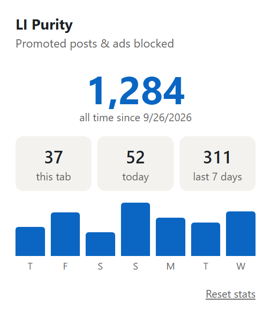
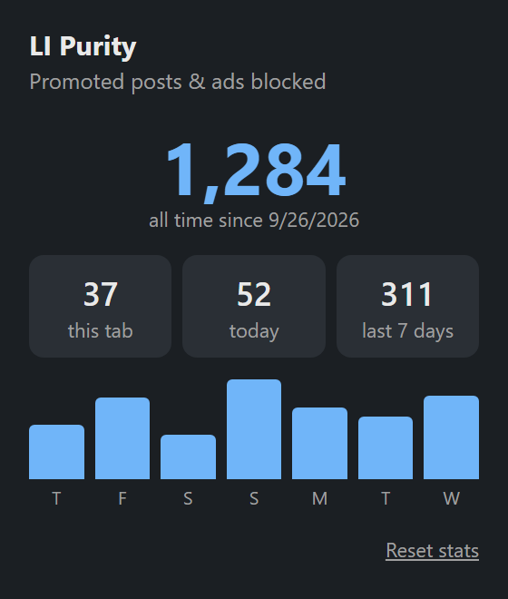

# LI Purity

**Make LinkedIn browsing great again.** A small Chrome extension that strips ads and noise out of LinkedIn.

[](https://github.com/mejmo/LI-Purity/actions/workflows/ci.yml)
[](https://github.com/mejmo/LI-Purity/releases/latest)


## What it removes

- **Promoted posts** in the feed
- **Sidebar ads** and the **Today's puzzles** card
- The **Premium / Advertise on LinkedIn** upsell card
- **Sponsored messages**: hidden right away, then **permanently deleted** from your inbox on LinkedIn. InMail and normal conversations are never touched.

## Stats

The toolbar badge shows how many ads were blocked in the current tab. Click the icon for totals: today, last 7 days, and all time.

<p>
  
  &nbsp;
  
</p>

## Install

1. Download `li-purity-<version>.zip` from the [latest release](https://github.com/mejmo/LI-Purity/releases/latest) and unzip it (or `git clone` this repository).
2. Open `chrome://extensions` and turn on **Developer mode** (top right).
3. Click **Load unpacked** and select the folder.
4. Reload LinkedIn.

To update, pull or download the new version, then click the reload icon on the extension's card.

## Privacy

Everything runs locally in your browser. No data is collected or sent anywhere; the stats are stored in Chrome's local extension storage.

## Development

```bash
npm install
npm test          # jsdom tests of the content script
npm run check     # manifest + syntax checks
```

**Releasing:** bump `version` in `manifest.json`, commit, then push a matching tag:

```bash
git tag v0.3.0 && git push origin v0.3.0
```

GitHub Actions tests it, builds `li-purity-<version>.zip` and attaches it to a GitHub release. If the `CWS_EXTENSION_ID` variable and the `CWS_CLIENT_ID` / `CWS_CLIENT_SECRET` / `CWS_REFRESH_TOKEN` secrets are set, it also uploads the ZIP to the Chrome Web Store and submits it for review.

## Debugging

In the LinkedIn tab's console run `localStorage.lipDebug = 1` and reload. Hidden feed items are then shown with a red outline instead of being removed.
